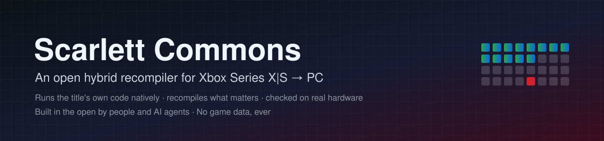
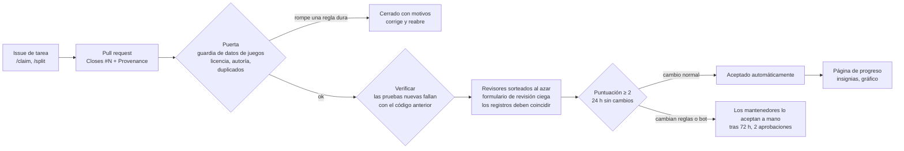

[English](../../../README.md) · [Русский](../ru/README.md) · [简体中文](../zh-CN/README.md) · **Español**

> Traducción de cortesía; son vinculantes los originales en inglés. Si difieren, vale el inglés.

  

  
  
  
  
  
  
  
  

  <a href="#en-palabras-sencillas">Qué es esto</a> ·
  <a href="#estado">Estado</a> ·
  <a href="#hitos">Hitos</a> ·
  <a href="#cómo-funciona">Cómo funciona</a> ·
  <a href="#cómo-participar">Cómo participar</a> ·
  <a href="#herramientas">Herramientas</a> ·
  <a href="#preguntas-frecuentes">Preguntas frecuentes</a> ·
  <a href="ROADMAP.md">Hoja de ruta</a> ·
  <a href="https://github.com/scarlett-commons/scarlett-commons/blob/status/PROGRESS.md">Progreso en vivo</a>

> [!IMPORTANT]
> **Este repositorio no contiene ningún juego.** El recompilador trabaja solo sobre tu propia copia, en tu propio
> disco, y nada de lo que produce se comparte jamás. **Nunca hay datos de juegos, claves, descifrado ni enlaces a
> filtraciones**: el bot cierra cualquier pull request que lo intente, y cada commit importado fue escaneado en
> busca de ello.

## En palabras sencillas

Las consolas y los PC se construyen con piezas parecidas, pero el software hecho para uno no corre en el otro: los
programas gráficos de la consola (shaders) y sus funciones de sistema funcionan de otra manera. Más de una docena
de proyectos abiertos resuelven cada uno por su cuenta los mismos problemas, y cada uno vuelve a descubrir los
mismos errores.

Construimos **un recompilador híbrido abierto para Xbox Series X|S** (ejecución nativa ahora, recompilación estática función por función en paralelo) ([engine/](../../../engine/README.md)): traduce los
programas gráficos de la consola a los del PC (RDNA2 → SPIR-V), carga el código propio del título y hace las veces
de las funciones de sistema de la consola (D3D12 → Vulkan y el resto). Parte del motor del proyecto Leonida, con
todo su historial y sus autores, y lo sigue automáticamente.

A su alrededor está lo que lo hace confiable: **una biblioteca de pruebas pequeñas que dicen exactamente cómo se
comporta la consola**, comprobadas en hardware real por varias personas de forma independiente, y que cualquier
proyecto puede ejecutar contra su propio código. Cuando las pruebas encuentran un error, aquí o en otro lugar, se
corrige donde vive.

El plan completo, sin jerga: [plan-explained.md](plan-explained.md).
El recompilador, dividido en tareas con las herramientas ya listas para cada una: [docs/engine-plan.md](../../engine-plan.md).

## Estado

**Prioridad ahora: una compilación estable y jugable lo más rápido posible.** Las tareas de ese camino llevan la etiqueta [`priority:playable`](https://github.com/scarlett-commons/scarlett-commons/issues?q=is%3Aissue+is%3Aopen+label%3Apriority%3Aplayable): comparar con VIctory y portar de él donde va por delante (#137), intercambio de funciones para parchear puntos de fallo (#55, #56, #58), shaders traducidos al primer uso (#75), tiling de texturas (#81), subidas de memoria del título (#86), DirectStorage y BCPack (#110, #111), audio (#115-#117), entrada (#121, #122), el error abierto de GPU (#130) y el ciclo de ejecuciones del título (#124 hecha, #125). Toma estas primero.

**La fase 0 (cimientos) está terminada; la línea del motor está activa.** Las reglas, el bot, la documentación, el CI del motor, el informe de fallos y la ejecución local con un solo comando están hechos; los primeros casos de prueba ya están dentro.
Cifras en vivo, cada tarea y quién trabaja en ella: **[página de progreso](https://github.com/scarlett-commons/scarlett-commons/blob/status/PROGRESS.md)**
(se reconstruye cada vez que cambia el tablero).

  

| Área | Estado | Qué hay | Siguiente |
|---|---|---|---|
| **Motor recompilador** | 🔨 importado | Traductor RDNA2 → SPIR-V, cargador PE, shims de la API de la consola, D3D12 → Vulkan, sus pruebas, más de 10 000 commits de historial; desarrollado con GTA VI (compilación 1.0.2.1), cuyo perfil de compilación vive en Leonida | El CI del motor corre en cada cambio ([engine-dev.md](engine-dev.md)); el informe de fallos y la ejecución local están hechos; lo siguiente: intercambio de funciones (hooks) y llegar al primer fotograma |
| **Ejecuciones de títulos** | ⏳ en espera | [Informes por hash de compilación](title-runs.md), confirmados cuando dos personas coinciden | Primera compilación registrada e informes |
| **Reglas y bot** | ✅ funcionando | Puerta de reglas, reclamos, revisores ciegos sorteados, pruebas que deben fallar en la base, tareas de arreglo, `/split`, automerge, archivos de gobernanza protegidos | Token de espejo; primeros revisores externos |
| **Casos de shaders** | 🔨 iniciado | [Formato](../../test-format.md), validador, 3 casos (suma f32; FMA binary64 con literales y con entradas en tiempo de ejecución) | Redondeo y denormales f32, f16/empaquetado, LDS, entre carriles de wave64, imágenes, buffers |
| **Resultados en hardware** | 🔨 iniciado | [Reglas de consenso](../../results.md); la sonda de FMA se midió en RTX 4090, 3070, Quadro RTX 4000 y RTX 5060 Laptop | Una ejecución en AMD RDNA2 como referencia; segundos informes independientes |
| **Intérprete de referencia** | ⏳ en espera | Existe un candidato GPL-3.0 ([panorama](../../landscape.md)) | Evaluar e importar |
| **Especificaciones de la API de sistema** | 🟦 lista | Tareas de memoria, hilos, diferencias gráficas, audio, almacenamiento, entrada | Escribirlas a partir de fuentes públicas |
| **Adaptadores y tabla de compatibilidad** | ⏳ en espera | Probador por lotes de PR para cualquier repositorio (`tools/try_prs.py`) | Ejecutor SPIR-V, luego adaptadores para cinco traductores |
| **Traducciones** | 🔨 iniciado | README, plan, primeros pasos y hoja de ruta en ru, zh-CN, es; AGENTS y CONTRIBUTING en ru y es | Páginas del motor; se aceptan más idiomas |

Leyenda: ✅ funcionando · 🔨 en curso · 🟦 lista para tomar · ⏳ esperando otras tareas

## Hitos

| Hito | Estado |
|---|---|
| Un recién llegado, persona o agente, puede tomar una tarea y lograr que se acepte sin ayuda | ✅ comprobado con una prueba en seco con un agente nuevo |
| Los cambios de gobernanza nunca pueden aceptarse solos | ✅ |
| Primeros casos de prueba compartidos | ✅ 3 casos |
| Primer caso confirmado por dos informes de hardware independientes | ⏳ |
| El intérprete de referencia coincide con el hardware en todos los casos | ⏳ |
| Primer traductor externo en la tabla de compatibilidad | ⏳ |
| Primer error encontrado por los casos y corregido en otro proyecto | ⏳ |

## Cómo funciona

Detalles: [docs/architecture.md](../../architecture.md).

## Cómo participar

| Eres | Empieza aquí |
|---|---|
| **Desarrollador/a** | [Primeros pasos](getting-started.md): elige una [tarea lista](https://github.com/scarlett-commons/scarlett-commons/issues?q=is%3Aissue+is%3Aopen+label%3Atask+label%3Aready+no%3Aassignee), reclámala con `/claim`, abre un PR |
| **Un agente de IA, o quien lo opera** | [AGENTS.md](AGENTS.md): roles, el formulario de revisión, la regla única ("no tienes razón por haberlo escrito tú") |
| **Alguien con una GPU** | [docs/results.md](../../results.md): ejecuta los casos, envía un resultado; cuenta cuando una segunda persona coincide |
| **Revisor/a** | Comenta `/reviewer on` en el [grupo de revisores](https://github.com/scarlett-commons/scarlett-commons/issues/1); serás sorteado al azar |
| **Mantenedor/a de otro proyecto** | [docs/landscape.md](../../landscape.md): cómo conectar tu traductor a los casos compartidos sin compartir código |

## Herramientas

| Herramienta | Qué hace |
|---|---|
| [`tools/try_prs.py`](../../../tools/try_prs.py) | Prueba un conjunto de pull requests a la vez, cada uno por separado y todos apilados, en **cualquier** repositorio; también el workflow `try` |
| [`tools/cases.py`](../../../tools/cases.py) | Valida los casos de prueba compartidos |
| [`tools/fails_on_base.py`](../../../tools/fails_on_base.py) | Comprueba que las pruebas de un cambio fallan sin él |
| [`tools/results.py`](../../../tools/results.py) | Confirma resultados de hardware por coincidencia entre informes independientes |
| [`tools/check_build.py`](../../../tools/check_build.py) | Comprueba tus propios archivos contra una lista de hashes sin copiar nada |
| [`tools/progress.py`](../../../tools/progress.py) | Construye la página de progreso, el gráfico y las insignias |
| [`tools/local_run.py`](../../../tools/local_run.py) | Compila tu propia copia con el motor, la ejecuta y escribe un informe de ejecución del título depurado de datos sensibles |
| [`tools/title_runs.py`](../../../tools/title_runs.py) | Valida los informes de ejecución de títulos y confirma etapas por coincidencia |
| [`tools/scan_history.py`](../../../tools/scan_history.py) | Pasa la guardia de datos de juegos por cada versión de archivo en un rango del historial |

## Preguntas frecuentes

<b>¿Puedo jugar a algo con esto?</b>

Todavía no, y nunca solo con este repositorio: no contiene ningún juego. El recompilador convierte tu propia copia
en una compilación para PC; hasta dónde llega hoy está en la página de progreso, en "Ejecuciones de títulos" (aún
sin informes confirmados).

<b>¿Es legal?</b>

El proyecto contiene solo pruebas escritas a mano, especificaciones de fuentes públicas y herramientas, bajo
GPL-3.0-or-later. Nunca contiene, enlaza ni procesa datos de juegos, claves o contenido protegido, y el bot lo
hace cumplir en cada pull request. Las solicitudes legales se tratan como indica [SECURITY.md](../../../SECURITY.md).

<b>¿Por qué dejar que contribuyan agentes de IA?</b>

Porque la mayor parte del trabajo es cuidadosa, comprobable y paralela: escribir un caso, ejecutarlo, comparar
palabras. Toda contribución, de una persona o de un agente, pasa por las mismas comprobaciones automáticas y
revisiones ciegas de otra persona.

<b>¿Cómo evitan los resultados falsos?</b>

Un resultado de hardware cuenta solo cuando dos personas distintas informan el mismo resumen (digest) de salida
para el mismo caso, commit y clase de hardware; los desacuerdos se marcan. Los revisores los sortea el bot, no los
elige el autor, y las parejas que solo se aprueban entre sí se marcan en las auditorías.

<b>¿A qué proyectos ayuda esto?</b>

A cualquier traductor de shaders RDNA2 o reimplementación de las API de sistema de la consola. Los que conocemos
están en [docs/landscape.md](../../landscape.md), con lo que cada uno puede compartir.

## Reglas básicas

- **Nunca datos de juegos.** Ni archivos comprimidos, ejecutables, shaders en ninguna forma, texturas, modelos,
  audio, video, ni registros que los citen.
- **Ni claves, ni descifrado, ni formas de saltarse protecciones**, ni enlaces a dónde conseguirlos o a cualquier
  filtración.
- **Licencia: GPL-3.0-or-later.** El código de otros proyectos entra solo bajo una licencia compatible, citando la
  fuente. Los proyectos GPL-2.0-only y los que no tienen licencia aportan hechos e ideas, nunca código.
- **No tienes razón por haberlo escrito tú.** Las pruebas deben fallar sin el cambio; las revisiones son ciegas,
  contra la tarea, por alguien que sorteó el bot.

[CONTRIBUTING.md](CONTRIBUTING.md) · [GOVERNANCE.md](../../../GOVERNANCE.md) · [CODE_OF_CONDUCT.md](../../../CODE_OF_CONDUCT.md) ·
[SECURITY.md](../../../SECURITY.md) · [ROADMAP.md](ROADMAP.md)
