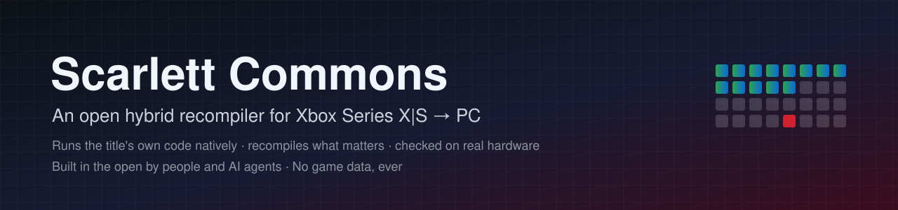
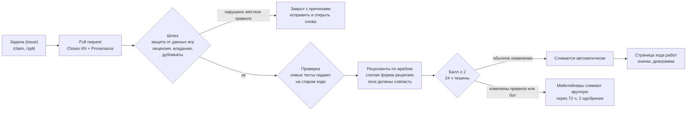

[English](../../../README.md) · **Русский** · [简体中文](../zh-CN/README.md) · [Español](../es/README.md)

> Перевод для удобства; обязательны английские оригиналы. Если они расходятся, верен английский.

  

  
  
  
  
  
  
  
  

  <a href="../../../README.md">English</a> · <b>Русский</b> · <a href="../zh-CN/README.md">简体中文</a> · <a href="../es/README.md">Español</a>

  <a href="#простыми-словами">Что это</a> ·
  <a href="#состояние">Состояние</a> ·
  <a href="#вехи">Вехи</a> ·
  <a href="#как-это-работает">Как это работает</a> ·
  <a href="#как-подключиться">Как подключиться</a> ·
  <a href="#инструменты">Инструменты</a> ·
  <a href="#частые-вопросы">Вопросы</a> ·
  <a href="./ROADMAP.md">Дорожная карта</a> ·
  <a href="https://github.com/scarlett-commons/scarlett-commons/blob/status/PROGRESS.md">Ход работ онлайн</a>

> [!IMPORTANT]
> **В этом репозитории нет игры.** Рекомпилятор работает только с вашей собственной копией, на вашем диске, и
> ничто из того, что он создаёт, никогда не публикуется. **Никаких данных игр, ключей, расшифровки и ссылок на
> утечки, никогда**: бот закрывает любой pull request с такой попыткой, а каждый импортированный коммит был
> проверен на это.

## Простыми словами

Консоли и ПК собирают из похожих деталей, но программа, написанная для одной платформы, не запускается на другой:
графические программы консоли (шейдеры) и её системные функции устроены иначе. Больше десятка открытых проектов
решают одни и те же задачи каждый сам по себе, и каждый заново находит одни и те же ошибки.

Мы строим **открытый гибридный рекомпилятор для Xbox Series X|S** (сейчас родное исполнение, а параллельно
статическая рекомпиляция функция за функцией) ([engine/](../../../engine/README.md)): он переводит графические
программы консоли в программы для ПК (RDNA2 → SPIR-V), загружает собственный код игры и подменяет системные
функции консоли (D3D12 → Vulkan и остальное). За основу взят движок проекта Leonida, со всей историей и
авторами, и мы автоматически следуем за ним.

Вокруг него есть то, что делает его надёжным: **библиотека небольших тестов, которые точно описывают поведение
консоли**. Их независимо проверяют на реальном железе несколько человек, и любой проект может запустить их
против своего кода. Если тесты находят ошибку, здесь или в другом проекте, она исправляется там, где живёт.

Весь план без жаргона: [docs/plan-explained.md](./plan-explained.md).
Рекомпилятор, разбитый на задачи, с готовыми инструментами для каждой: [docs/engine-plan.md](../../engine-plan.md).

## Состояние

**Приоритет сейчас: как можно быстрее получить стабильную, играбельную сборку.** Задачи на этом пути помечены
меткой [`priority:playable`](https://github.com/scarlett-commons/scarlett-commons/issues?q=is%3Aissue+is%3Aopen+label%3Apriority%3Aplayable): сравнение с VIctory и перенос оттуда того, где он впереди (#137), подмена функций для обхода мест падений (#55, #56, #58), шейдеры, переводимые при первом использовании (#75), тайлинг текстур (#81), загрузки в память игры (#86), DirectStorage и BCPack (#110, #111), звук (#115-#117), ввод (#121, #122), открытая ошибка GPU (#130) и цикл прогонов игры (#124 готово, #125). Берите их в первую очередь.

**Этап 0 (фундамент) завершён; идёт работа над движком.** Правила, бот, документация, CI движка, отчёт о падении и локальный запуск одной командой готовы; первые тестовые случаи добавлены.
Актуальные цифры, все задачи и кто над ними работает: **[страница хода работ](https://github.com/scarlett-commons/scarlett-commons/blob/status/PROGRESS.md)**
(пересобирается при каждом изменении доски).

  

| Направление | Состояние | Что есть | Дальше |
|---|---|---|---|
| **Движок-рекомпилятор** | 🔨 импортирован | Транслятор RDNA2 → SPIR-V, загрузчик PE, заменители API консоли, D3D12 → Vulkan, их тесты, более 10 000 коммитов истории; разрабатывается на GTA VI (сборка 1.0.2.1), профиль сборки которой лежит в Leonida | CI движка запускается при каждом изменении ([engine-dev.md](./engine-dev.md)); отчёт о падении и локальный запуск готовы; дальше: подмена функций (хуки) и выход к первому кадру |
| **Прогоны игры** | ⏳ ждёт | [Отчёты по хешу сборки](./title-runs.md), подтверждаются, когда двое совпали | Первая зарегистрированная сборка и отчёты |
| **Правила и бот** | ✅ работает | Проверка правил, заявки, слепые рецензенты по жребию, тесты должны падать на базе, задачи на доработку, `/split`, автослияние, защищённые файлы управления | Токен зеркала; первые сторонние рецензенты |
| **Шейдерные случаи** | 🔨 начато | [Формат](../../test-format.md), валидатор, 3 случая (сложение f32; FMA binary64 как литералы и как входные данные во время выполнения) | Округление и денормализованные числа f32, f16/упакованные, LDS, межпотоковые операции wave64, изображения, буферы |
| **Результаты на железе** | 🔨 начато | [Правила консенсуса](../../results.md); проба FMA измерена на RTX 4090, 3070, Quadro RTX 4000 и RTX 5060 Laptop | Запуск на AMD RDNA2 как эталон; вторые независимые отчёты |
| **Эталонный интерпретатор** | ⏳ ждёт | Есть кандидат под GPL-3.0 ([обзор](../../landscape.md)) | Оценить и импортировать |
| **Спецификации системных API** | 🟦 готово | Задачи по памяти, потокам, различиям графики, звуку, хранилищу, вводу | Написать по открытым источникам |
| **Адаптеры и таблица совместимости** | ⏳ ждёт | Пакетный тестер PR для любого репозитория (`tools/try_prs.py`) | Запуск SPIR-V, затем адаптеры для пяти трансляторов |
| **Переводы** | 🔨 начато | README, план, быстрый старт и дорожная карта на ru, zh-CN, es; AGENTS и CONTRIBUTING на ru | Страницы про движок; другие языки приветствуются |

Обозначения: ✅ работает · 🔨 в работе · 🟦 можно брать · ⏳ ждёт других задач

## Вехи

| Веха | Состояние |
|---|---|
| Новичок, человек или агент, может взять задачу и добиться слияния без чьей-либо помощи | ✅ проверено пробным прогоном со свежим агентом |
| Изменения правил управления никогда не сливаются сами | ✅ |
| Первые общие тестовые случаи | ✅ 3 случая |
| Первый случай, подтверждённый двумя независимыми отчётами с железа | ⏳ |
| Эталонный интерпретатор совпадает с железом на каждом случае | ⏳ |
| Первый внешний транслятор в таблице совместимости | ⏳ |
| Первая ошибка, найденная случаями и исправленная в другом проекте | ⏳ |

## Как это работает

Подробности: [docs/architecture.md](../../architecture.md).

## Как подключиться

| Вы | С чего начать |
|---|---|
| **Разработчик** | [Быстрый старт](./getting-started.md): выберите [готовую задачу](https://github.com/scarlett-commons/scarlett-commons/issues?q=is%3Aissue+is%3Aopen+label%3Atask+label%3Aready+no%3Aassignee), заявите её через `/claim`, откройте PR |
| **ИИ-агент или его оператор** | [AGENTS.md](./AGENTS.md): роли, форма рецензии, главное правило («вы не правы только потому, что это написали вы») |
| **Владелец видеокарты** | [docs/results.md](../../results.md): запустите случаи, отправьте результат; он засчитывается, когда второй человек с ним согласен |
| **Рецензент** | Напишите `/reviewer on` в [пуле рецензентов](https://github.com/scarlett-commons/scarlett-commons/issues/1); вас выберут по жребию |
| **Мейнтейнер другого проекта** | [docs/landscape.md](../../landscape.md): как подключить ваш транслятор к общим случаям, не делясь кодом |

## Инструменты

| Инструмент | Что делает |
|---|---|
| [`tools/try_prs.py`](../../../tools/try_prs.py) | Проверяет сразу набор pull request'ов, каждый отдельно и все вместе, в **любом** репозитории; это же рабочий процесс `try` |
| [`tools/cases.py`](../../../tools/cases.py) | Проверяет общие тестовые случаи |
| [`tools/fails_on_base.py`](../../../tools/fails_on_base.py) | Проверяет, что тесты изменения падают без него |
| [`tools/results.py`](../../../tools/results.py) | Подтверждает результаты на железе по согласию независимых отчётов |
| [`tools/check_build.py`](../../../tools/check_build.py) | Сверяет ваши файлы со списком хешей, ничего не копируя |
| [`tools/progress.py`](../../../tools/progress.py) | Собирает страницу хода работ, диаграмму и значки |
| [`tools/local_run.py`](../../../tools/local_run.py) | Собирает вашу копию с движком, запускает её и пишет очищенный отчёт о прогоне |
| [`tools/title_runs.py`](../../../tools/title_runs.py) | Проверяет отчёты о прогонах и подтверждает стадии по согласию |
| [`tools/scan_history.py`](../../../tools/scan_history.py) | Прогоняет защиту от данных игр по каждой версии каждого файла в диапазоне истории |

## Частые вопросы

<b>Можно ли с этим во что-нибудь поиграть?</b>

Пока нет, а из одного этого репозитория не получится никогда: в нём нет игры. Рекомпилятор превращает вашу
собственную копию в сборку для ПК; докуда это сегодня доходит, видно на странице хода работ в разделе «Прогоны
игры» (подтверждённых отчётов пока нет).

<b>Это законно?</b>

В проекте только написанные вручную тесты, спецификации по открытым источникам и инструменты, под лицензией
GPL-3.0-or-later. В нём никогда нет данных игр, ключей и защищённого содержимого, ссылок на них, и их обработки,
и бот проверяет это в каждом pull request. Юридические обращения обрабатываются, как описано в [SECURITY.md](../../../SECURITY.md).

<b>Зачем допускать ИИ-агентов?</b>

Потому что большая часть работы тщательная, проверяемая и параллельная: написать случай, запустить, сравнить
слова. Любой вклад, от человека или от агента, проходит одни и те же автоматические проверки и слепую
рецензию кого-то другого.

<b>Как вы защищаетесь от поддельных результатов?</b>

Результат на железе засчитывается, только когда двое разных людей сообщают один и тот же хеш вывода для
одного и того же случая, коммита и класса железа; расхождения помечаются. Рецензентов выбирает бот, а не автор,
и пары, которые только одобряют друг друга, помечаются при аудитах.

<b>Каким проектам это помогает?</b>

Любому транслятору шейдеров RDNA2 и любой повторной реализации системных API консоли. Известные нам проекты
перечислены в [docs/landscape.md](../../landscape.md) вместе с тем, чем каждый может поделиться.

## Основные правила

- **Никаких данных игр, никогда.** Никаких архивов, исполняемых файлов, шейдеров в любом виде, текстур, моделей,
  звука, видео и логов, которые их цитируют.
- **Никаких ключей, расшифровки и обхода защиты**, и никаких ссылок на то, где их взять, или на любую утечку.
- **Лицензия: GPL-3.0-or-later.** Код из других проектов принимается только под совместимой лицензией, с
  указанием источника. Проекты под GPL-2.0-only и без лицензии дают факты и идеи, но не код.
- **Вы не правы только потому, что это написали вы.** Тесты должны падать без изменения; рецензии слепые, по
  задаче, от того, кого выбрал бот.

[CONTRIBUTING.md](./CONTRIBUTING.md) · [GOVERNANCE.md](../../../GOVERNANCE.md) · [CODE_OF_CONDUCT.md](../../../CODE_OF_CONDUCT.md) ·
[SECURITY.md](../../../SECURITY.md) · [ROADMAP.md](./ROADMAP.md)
