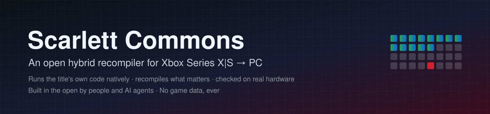
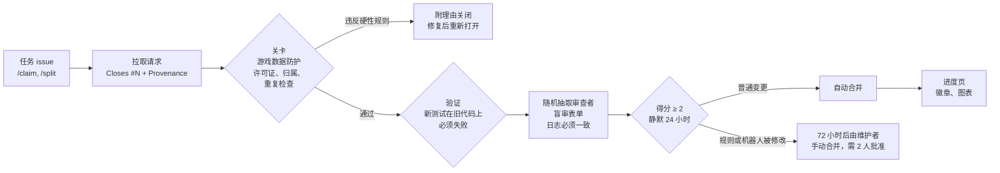

[English](../../../README.md) · [Русский](../ru/README.md) · **简体中文** · [Español](../es/README.md)

> 译文仅供参考，具有约束力的是英文原文；如有出入，以英文为准。

  

  
  
  
  
  
  
  
  

  <a href="#in-plain-words">这是什么</a> ·
  <a href="#status">现状</a> ·
  <a href="#milestones">里程碑</a> ·
  <a href="#how-it-works">工作方式</a> ·
  <a href="#get-involved">参与</a> ·
  <a href="#tools">工具</a> ·
  <a href="#faq">常见问题</a> ·
  <a href="ROADMAP.md">路线图</a> ·
  <a href="https://github.com/scarlett-commons/scarlett-commons/blob/status/PROGRESS.md">实时进度</a>

> [!IMPORTANT]
> **本仓库不含任何游戏。** 重编译器只处理你自己磁盘上的你自己的那份副本，它生成的任何内容都绝不会被分享。
> **任何时候都不允许出现游戏数据、密钥、解密手段或泄露资源的链接**：机器人会关闭任何尝试这样做的
> 拉取请求（PR），并且每一个导入的提交都已经过扫描。

## 通俗地说

主机和 PC 由相似的部件构成，但为一方编写的软件无法在另一方上运行：主机的图形程序（着色器）和系统函数
的工作方式不同。十几个开源项目各自在解决同样的问题，每一个都在重新踩同样的坑。

我们在构建**一个面向 Xbox Series X|S 的开放混合式重编译器**（目前原生执行，同时逐函数并行进行静态重编译）（[engine/](../../../engine/README.md)）：它把主机的图形程序翻译成 PC 的
图形程序（RDNA2 → SPIR-V），加载游戏自带的代码，并替代主机的系统函数（D3D12 → Vulkan 等）。
它以 Leonida 项目的引擎为起点，完整保留其历史和作者，并自动与其保持同步。

围绕它的是让它值得信赖的东西：**一套精确描述主机行为的小型测试库**，由多位独立的人在真实硬件上检查，
任何项目都可以拿它来测试自己的代码。当测试发现了漏洞，无论在这里还是别处，都会在漏洞所在的地方修复。

不带术语的完整计划：[docs/plan-explained.md](plan-explained.md)。
把重编译器拆成任务，并为每个任务配好现成工具：[docs/engine-plan.md](../../engine-plan.md)。

## 现状

**当前优先级：尽快得到稳定、可玩的构建。** 这条路径上的任务带有标签 [`priority:playable`](https://github.com/scarlett-commons/scarlett-commons/issues?q=is%3Aissue+is%3Aopen+label%3Apriority%3Aplayable)：与 VIctory 对比，并在其领先之处移植过来（#137）；用函数替换来修补崩溃点（#55、#56、#58）；首次使用时翻译着色器（#75）；纹理平铺（#81）；游戏内存上传（#86）；DirectStorage 与 BCPack（#110、#111）；音频（#115-#117）；输入（#121、#122）；未解决的 GPU 漏洞（#130）；以及游戏运行循环（#124 已完成，#125）。请优先领取这些任务。

**阶段 0（基础建设）已完成；引擎主线正在推进。** 规则、机器人、文档、引擎 CI、崩溃报告和一条命令的本地运行都已就绪；第一批测试用例也已加入。
实时数据、所有任务以及负责人：**[进度页](https://github.com/scarlett-commons/scarlett-commons/blob/status/PROGRESS.md)**
（看板一有变化就会重新生成）。

  

| 领域 | 状态 | 已有内容 | 下一步 |
|---|---|---|---|
| **重编译器引擎** | 🔨 已导入 | RDNA2 → SPIR-V 翻译器、PE 加载器、主机 API 垫片、D3D12 → Vulkan、相应测试，以及超过 10,000 个提交的历史；针对 GTA VI（构建 1.0.2.1）开发，其构建配置存放在 Leonida 中 | 每次变更都会运行引擎 CI（[engine-dev.md](engine-dev.md)）；崩溃报告和本地运行已就绪；下一步：函数替换（hook）并到达第一帧 |
| **游戏运行** | ⏳ 等待中 | [按构建哈希提交的报告](title-runs.md)，两个人一致即视为确认 | 第一个登记的构建和报告 |
| **规则与机器人** | ✅ 运行中 | 规则关卡、认领、随机抽取的盲审审查者、测试必须在旧代码上失败、修复任务、`/split`、自动合并、受保护的治理文件 | 镜像令牌；第一批外部审查者 |
| **着色器用例** | 🔨 已开始 | [格式](../../test-format.md)、校验器、3 个用例（f32 加法；binary64 FMA，分别用字面量和运行时输入） | f32 舍入与非规格化数、f16/打包、LDS、wave64 跨通道、图像、缓冲区 |
| **硬件结果** | 🔨 已开始 | [共识规则](../../results.md)；FMA 探测已在 RTX 4090、3070、Quadro RTX 4000 和 RTX 5060 Laptop 上测得 | 以一次 AMD RDNA2 运行作为基准；第二份独立报告 |
| **参考解释器** | ⏳ 等待中 | 已有一个 GPL-3.0 候选（[现状调研](../../landscape.md)） | 评估并导入 |
| **系统 API 规范** | 🟦 可领取 | 内存、线程、图形差异、音频、存储、输入方面的任务 | 依据公开资料撰写 |
| **适配器与兼容性表** | ⏳ 等待中 | 适用于任意仓库的批量 PR 测试器（`tools/try_prs.py`） | SPIR-V 运行器，然后是五个翻译器的适配器 |
| **翻译** | 🔨 已开始 | README、计划、入门和路线图已有 ru、zh-CN、es 版本；AGENTS 和 CONTRIBUTING 已有 ru 版本 | 引擎相关页面；欢迎更多语言 |

图例：✅ 运行中 · 🔨 进行中 · 🟦 可领取 · ⏳ 等待其他任务

## 里程碑

| 里程碑 | 状态 |
|---|---|
| 新人（无论是人还是智能体）无需帮助就能领取任务并让它被合并 | ✅ 已用全新的智能体做过一次演练验证 |
| 治理类变更永远不能自行合并 | ✅ |
| 第一批共享测试用例 | ✅ 3 个用例 |
| 第一个用例获得两份独立硬件报告的确认 | ⏳ |
| 参考解释器在每个用例上都与硬件一致 | ⏳ |
| 兼容性表中出现第一个外部翻译器 | ⏳ |
| 第一个由用例发现、并在另一个项目中修复的漏洞 | ⏳ |

## 工作方式

详情：[docs/architecture.md](../../architecture.md)。

## 参与

| 你是 | 从这里开始 |
|---|---|
| **开发者** | [入门](getting-started.md)：挑一个[可领取的任务](https://github.com/scarlett-commons/scarlett-commons/issues?q=is%3Aissue+is%3Aopen+label%3Atask+label%3Aready+no%3Aassignee)，用 `/claim` 认领，然后提交 PR |
| **AI 智能体或其运营者** | [AGENTS.md](AGENTS.md)：角色、审查表单、唯一的规则（“你写的东西，不会因为是你写的就是对的”） |
| **有 GPU 的人** | [docs/results.md](../../results.md)：运行用例并提交结果；有第二个人一致时才算数 |
| **审查者** | 在[审查者池](https://github.com/scarlett-commons/scarlett-commons/issues/1)里评论 `/reviewer on`；你会被随机抽中 |
| **其他项目的维护者** | [docs/landscape.md](../../landscape.md)：你的翻译器如何在不共享代码的前提下接入共享用例 |

## 工具

| 工具 | 作用 |
|---|---|
| [`tools/try_prs.py`](../../../tools/try_prs.py) | 在**任意**仓库中一次测试一组拉取请求，分别单独测试和全部叠加测试；也是 `try` 工作流 |
| [`tools/cases.py`](../../../tools/cases.py) | 校验共享测试用例 |
| [`tools/fails_on_base.py`](../../../tools/fails_on_base.py) | 检查一个变更的测试在没有该变更时会失败 |
| [`tools/results.py`](../../../tools/results.py) | 通过独立报告之间的一致来确认硬件结果 |
| [`tools/check_build.py`](../../../tools/check_build.py) | 对照哈希列表检查你自己的文件，不复制任何内容 |
| [`tools/progress.py`](../../../tools/progress.py) | 生成进度页、图表和徽章 |
| [`tools/local_run.py`](../../../tools/local_run.py) | 用引擎构建你自己的副本并运行，写出经过清理的游戏运行报告 |
| [`tools/title_runs.py`](../../../tools/title_runs.py) | 校验游戏运行报告，并通过一致性确认阶段 |
| [`tools/scan_history.py`](../../../tools/scan_history.py) | 对一段历史范围内的每个文件版本运行游戏数据防护 |

## 常见问题

<b>我能用它玩什么吗？</b>

目前还不能，而且光靠本仓库永远不行：它不含游戏。重编译器把你自己的副本变成 PC 构建；目前能走多远，
见进度页的“Title runs”（游戏运行）一栏（目前还没有已确认的报告）。

<b>这合法吗？</b>

本项目只包含手写的测试、基于公开资料的规范和工具，采用 GPL-3.0-or-later 许可。它绝不包含、链接或处理
游戏数据、密钥或受保护内容，机器人会对每个拉取请求强制检查这一点。法律方面的请求按
[SECURITY.md](../../../SECURITY.md) 处理。

<b>为什么允许 AI 智能体贡献？</b>

因为大部分工作都是细致、可检查、可并行的：写一个用例，运行它，比对输出。每一份贡献，无论来自人还是智能体，
都要面对同样的自动检查，以及他人的盲审。

<b>如何防止伪造结果？</b>

只有当两个不同的人针对同一个用例、同一个提交和同一类硬件报告了相同的输出摘要，硬件结果才算数；
不一致会被标记。审查者由机器人抽取，而不是由作者挑选，只互相批准对方的人员配对会在审计中被标记。

<b>这对哪些项目有帮助？</b>

任何 RDNA2 着色器的翻译器，或主机系统 API 的重新实现。我们已知的项目列在
[docs/landscape.md](../../landscape.md) 中，并注明各自能共享什么。

## 基本规则

- **绝不包含游戏数据。** 不得有压缩包、可执行文件、任何形式的着色器、纹理、模型、音频、视频，
  或引用它们的日志。
- **不得有密钥、解密或绕过保护的手段**，也不得链接到获取它们的途径或任何泄露资源。
- **许可证：GPL-3.0-or-later。** 来自其他项目的代码只有在许可证兼容且注明来源时才能引入。
  仅 GPL-2.0 的项目和没有许可证的项目只能提供事实和思路，不能提供代码。
- **你写的东西，不会因为是你写的就是对的。** 测试必须在没有该变更时失败；审查是盲审，
  依据任务，由机器人抽取的人来做。

[CONTRIBUTING.md](CONTRIBUTING.md) · [GOVERNANCE.md](../../../GOVERNANCE.md) · [CODE_OF_CONDUCT.md](../../../CODE_OF_CONDUCT.md) ·
[SECURITY.md](../../../SECURITY.md) · [ROADMAP.md](ROADMAP.md)
